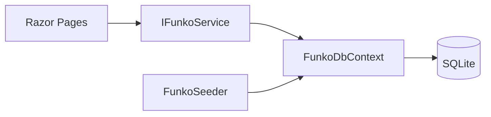

# FunkoApp

Tienda de Funkos hecha con Razor Pages.

## Estructura

| Proyecto | Qué es |
|----------|--------|
| `FunkoApp` | Aplicación web con Razor Pages: páginas, layout y parciales |
| `FunkoApp.Shared` | Modelo, datos, servicios e infraestructura, separados de la presentación |
| `FunkoApp.Test` | Pruebas con NUnit, Moq y FluentAssertions |

## Arquitectura

Las páginas solo se ocupan de la presentación. El negocio y los datos viven en `FunkoApp.Shared`.



El servicio devuelve DTOs, nunca la entidad: las páginas no conocen el modelo de la base de datos.

## Cómo se ejecuta

Requiere el SDK de .NET 10.

```powershell
dotnet run --project FunkoApp
```

Escucha en http://localhost:5147.

En Development la base de datos SQLite (`funkos.db`) se borra y se recrea con datos de ejemplo en cada arranque.

## Cómo se prueba

```powershell
dotnet test
```

Las pruebas usan NUnit y FluentAssertions, con el patrón AAA y las clases `CasosPositivos` y `CasosNegativos`. El servicio se prueba contra EF Core en memoria, con una base de datos nueva por prueba.

## Documentación

El diseño en papel (modelo de datos y mapa de páginas) está en [docs/diseno.md](docs/diseno.md).

## Decisiones tomadas

- **Solo Razor Pages.** No se hace la versión MVC: el proyecto se centra en una única visión.
- **Negocio separado de las páginas.** `FunkoApp.Shared` contiene el modelo, los datos y los servicios, como en las soluciones del profesor, para que las páginas solo se ocupen de la presentación.
- **Avisos como errores.** Los proyectos compilan con `TreatWarningsAsErrors`. Se silencia `CS1591` (falta de comentario XML), como hace el profesor; la documentación XML se escribe igualmente.
- **Servicio sin `Result`.** El servicio devuelve DTOs y `null` o `bool`, como el profesor en esta unidad. Es una desviación consciente de la arquitectura con `Result<T, DomainError>` de otros proyectos.
- **Entidad limpia.** Las entidades no llevan atributos: las restricciones de la base de datos se declaran con Fluent API en `FunkoDbContext`. Las validaciones del formulario irán en el ViewModel.
- **Nombres.** Los tipos van en inglés (`Funko`, `Category`) y las propiedades en español (`Nombre`, `Anio`, `PrecioReferencia`), como en el enunciado y en las soluciones del profesor.
- **Borrado de categorías.** Una categoría con Funkos no se puede borrar (`DeleteBehavior.Restrict`).
- **Base de datos.** SQLite en fichero para la aplicación y EF Core en memoria para las pruebas.
- **Búsqueda sin distinguir mayúsculas.** Se usa `EF.Functions.Like`, que en SQLite ignora mayúsculas en letras sin acento. Con tildes, buscar en mayúsculas no encuentra el nombre en minúsculas. Lo detectó una prueba que fallaba antes del arreglo.
- **Imagen por defecto.** Un Funko sin imagen muestra `/images/funko-sin-imagen.svg`.
- **Alcance.** Solo se cubre el temario hasta el punto 16. Quedan fuera usuarios e Identity, cesta y estado, internacionalización, caché, Docker y Playwright.

## Estado

Hecho:

- Diseño en papel y esqueleto de la solución.
- Modelo (`Funko` y `Category`), `DbContext` con Fluent API, DTOs, mapper y servicio de lectura del catálogo.
- Semilla de ejemplo con SQLite.
- Portada con el catálogo, buscador por nombre, parcial de la tarjeta y página de Funkos por categoría.
- Pruebas del mapper y del servicio.

Pendiente: página Acerca de, layout con la barra de navegación y el pie, crear, editar y eliminar Funkos, subida de imágenes y pruebas de las páginas.