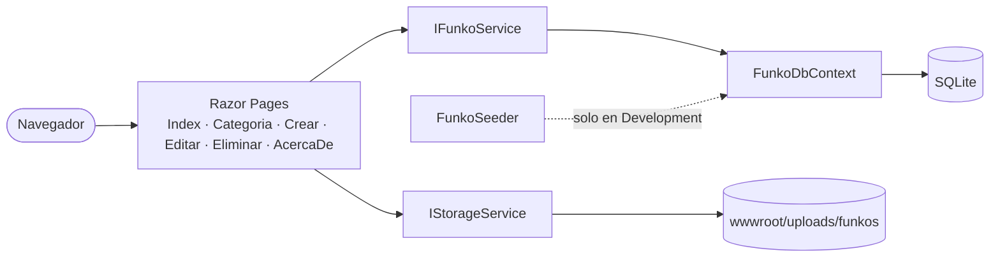
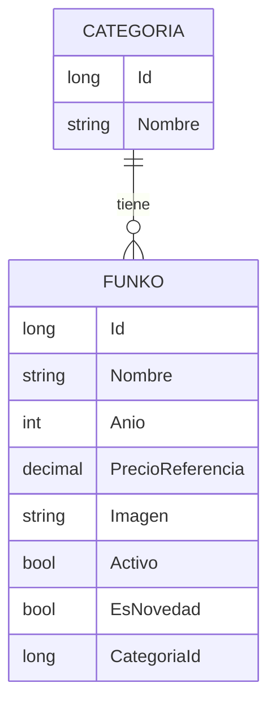
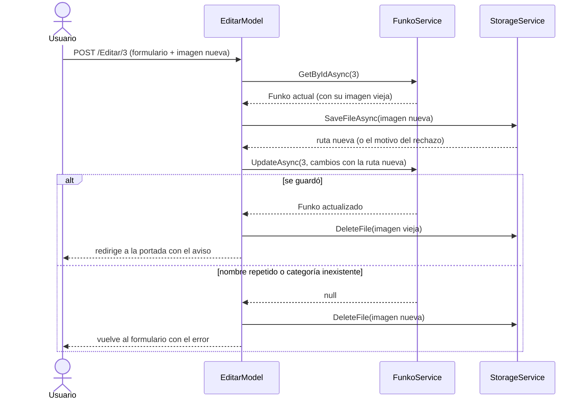

# FunkoApp


Práctica de la unidad 3 de Desarrollo Web en Entorno Servidor (DWES): desarrollo de páginas web dinámicas en .NET.

Es una tienda de Funkos (figuras de vinilo coleccionables) hecha con **Razor Pages**: un catálogo
que se puede buscar y filtrar por categoría, con alta, edición y eliminación de Funkos y subida de su imagen.

**Autores:** Cristian Álvarez · Jesús Cobo

---

## 🎯 Qué hace

- **Catálogo** con todos los Funkos, su imagen, su categoría, su año y su precio con IVA.
- **Buscador por nombre** que no distingue mayúsculas.
- **Una página por categoría**, a la que se llega desde el menú. El menú sale de la base de datos: si se añade una categoría, aparece sola.
- **Crear, editar y eliminar** Funkos. Editar y eliminar tienen su propia página, que muestra los datos del Funko.
- **Imagen del Funko**, opcional. Si no se sube ninguna se usa una por defecto. Al editar con otra imagen se borra la anterior del disco, y al eliminar el Funko se borra también su fichero.
- **Acerca de**, con la ficha de GitHub de los autores.
- Cabecera con la navegación y pie de página (2DAW · 2026) comunes a todas las páginas.

### Lo que pedía la pizarra, y dónde está

| Pizarra | Dónde está |
|---------|------------|
| Funko N — 1 Categoría | `Funko` y `Category`, relación configurada en `FunkoDbContext` |
| Navegación: Catálogo, categorías, Acerca de | `_Layout.cshtml` y el componente de vista `CategoryMenu` |
| Pinchar en una categoría muestra solo esa categoría | `Pages/Categoria.cshtml` (`/Categoria/{id}`) |
| Acerca de con la ficha de GitHub | `Pages/AcercaDe.cshtml` |
| Buscar filtra por nombre | `Pages/Index.cshtml` (`/?busqueda=`) |
| + Nuevo / Crear | `Pages/Crear.cshtml` |
| Imagen, o imagen por defecto | `FunkoMapper` y `wwwroot/images/funko-sin-imagen.svg` |
| Editar y Eliminar: página que muestra los datos | `Pages/Editar.cshtml` y `Pages/Eliminar.cshtml` |
| Editar con imagen actualiza y borra la vieja; eliminar borra | `EditarModel`, `EliminarModel` y `StorageService.DeleteFile` |
| ★ Limpiar en el formulario | Botón "Limpiar" de `Pages/Crear.cshtml` |
| Footer 2DAW 2026 | `_Layout.cshtml` |

---

## 🏗️ Arquitectura

Las páginas solo se ocupan de la presentación. El negocio, los datos y el almacenamiento viven en `FunkoApp.Shared`.



Una página nunca toca la base de datos ni el disco: pide al servicio y al almacén, y pinta lo que le devuelven.
El servicio devuelve DTOs, nunca la entidad, así que la vista no conoce el modelo de la base de datos.

### Modelo de datos



El nombre del Funko y el de la categoría son únicos. Una categoría con Funkos no se puede borrar.

### Qué pasa al editar un Funko con una imagen nueva

Es el flujo con más piezas. El orden importa: la imagen vieja solo se borra cuando los cambios ya están guardados.



Si el almacén rechaza la imagen, no se llega a llamar al servicio. Si el servicio rechaza los cambios, la imagen recién subida se borra para no dejarla huérfana.

### Páginas y rutas

| Ruta | Página | Qué hace |
|------|--------|----------|
| `/` | `Index` | Catálogo y buscador (`?busqueda=`) |
| `/Categoria/{id}` | `Categoria` | Funkos de una categoría; 404 si no existe |
| `/Crear` | `Crear` | Formulario de alta |
| `/Editar/{id}` | `Editar` | Formulario precargado; el `id` va en la ruta |
| `/Eliminar/{id}` | `Eliminar` | Muestra los datos y pide confirmar; el borrado es un POST |
| `/AcercaDe` | `AcercaDe` | Ficha de los autores |

Los formularios son `POST` con token antifalsificación, y siguen el patrón Post-Redirect-Get: tras un alta, una edición o un borrado correctos se redirige a la portada con el aviso en `TempData`.

---

## 📁 Estructura del proyecto

```
FunkoApp.slnx
├── FunkoApp/                       Razor Pages: lo que ve el usuario
│   ├── Pages/
│   │   ├── Index, Categoria, Crear, Editar, Eliminar, AcercaDe
│   │   └── Shared/                 _Layout, _TarjetaFunko, _FormularioFunko y el componente CategoryMenu
│   ├── ViewComponents/             CategoryMenuViewComponent
│   ├── wwwroot/images/             imagen por defecto
│   └── Program.cs                  índice de llamadas: solo configura y arranca
├── FunkoApp.Shared/                Negocio, datos y almacenamiento
│   ├── Binders/                    DecimalModelBinder
│   ├── Data/                       FunkoDbContext (Fluent API) y la semilla
│   ├── Dtos/                       FunkoDto, CategoryDto
│   ├── Infrastructure/             DatabaseConfig, ServicesConfig, MvcConfig, inicialización de la BD
│   ├── Mappers/                    entidad → DTO y formulario ↔ entidad
│   ├── Models/                     Funko, Category
│   ├── Services/                   IFunkoService y FunkoService
│   │   └── Storage/                IStorageService, StorageService y StorageResult
│   └── ViewModels/                 FunkoFormViewModel
├── FunkoApp.Test/                  Pruebas
│   ├── Binders/ Mappers/ Services/ Pages/
│   └── Integration/                La aplicación real por HTTP
└── docs/diseno.md                  Diseño en papel
```

---

## 📋 Requisitos

- SDK de **.NET 10**.
- No hace falta instalar nada más: la base de datos es un fichero SQLite que se crea solo.

## ▶️ Cómo ejecutarlo

```powershell
dotnet run --project FunkoApp
```

Escucha en http://localhost:5147.

### Qué verás al arrancar

En **Development** la aplicación borra `funkos.db` y lo recrea en cada arranque, con tres categorías (Tenistas, Marvel y Dragon Ball) y 15 Funkos de ejemplo. Los años y precios de la semilla son inventados.
En cualquier otro entorno solo crea el esquema si no existe y no siembra nada.

---

## ⚙️ Configuración

Todo está en `FunkoApp/appsettings.json`.

```json
{
  "Storage": {
    "UploadPath": "uploads",
    "MaxFileSize": 5242880,
    "AllowedExtensions": [ ".jpg", ".jpeg", ".png", ".gif" ]
  }
}
```

| Clave | Para qué | Por defecto |
|-------|----------|-------------|
| `ConnectionStrings:DefaultConnection` | Fichero SQLite | `Data Source=funkos.db` |
| `Storage:UploadPath` | Carpeta de subidas, dentro de `wwwroot` | `uploads` |
| `Storage:MaxFileSize` | Tamaño máximo por imagen, en bytes | 5 MB |
| `Storage:AllowedExtensions` | Extensiones admitidas | jpg, jpeg, png, gif |

Las imágenes subidas se guardan en `wwwroot/uploads/funkos`. Esa carpeta no se sube a git.

---

## 🧠 Decisiones de diseño

Se marcan con ★ las que salen de nosotros y no del material del profesor.

### Solo Razor Pages

La práctica pide dos visiones (Razor Pages y MVC). Nos centramos en una: el proyecto se queda en lo que trata la unidad y se hace bien. Se eliminó el proyecto MVC que había al principio.

### El negocio vive aparte de las páginas

`FunkoApp.Shared` contiene el modelo, los datos y los servicios, como las soluciones del profesor. Las páginas solo piden datos y los pintan. Gracias a eso se pueden probar las páginas con un servicio simulado.

### El servicio devuelve DTOs y `null` o `bool`, no `Result`

Es lo que hace el profesor en esta unidad. Es una desviación consciente de la arquitectura con `Result<T, DomainError>` de `RepositorioRemoto`, que aquí sería maquinaria de más. `CreateAsync` y `UpdateAsync` devuelven `null` si no se puede guardar, y `DeleteAsync` devuelve `false` si no existía.

### ★ Un `null` cubre varios motivos

`CreateAsync` y `UpdateAsync` devuelven `null` tanto si el nombre ya existe como si la categoría no existe (o, al editar, si el Funko ya no existe). El profesor no tiene el caso de la categoría. El formulario solo ofrece categorías válidas, así que ese caso solo ocurre con una petición manipulada, y la página muestra un mensaje que cubre todos los motivos.

### La entidad, limpia; la validación, en el ViewModel

Las restricciones de la base de datos están en Fluent API, dentro de `FunkoDbContext`. La validación del formulario son atributos (`Required`, `StringLength`, `Range`) en `FunkoFormViewModel`. No usamos FluentValidation: el formulario no tiene reglas que crucen datos, y las únicas que sí (nombre repetido) las resuelve el servicio.

### El precio acepta coma o punto

El binder por defecto lee el número con la cultura del servidor: en uno en español, "15.50" se leería como 1550. `DecimalModelBinder` acepta "15,50" y "15.50" y siempre convierte con la cultura invariable. Se registra con `AddMvcOptions`, porque en Razor Pages no va en `RazorPagesOptions`.

Una forma como "1.299,00" se **rechaza** con un error en lugar de adivinar qué separador es el decimal. El comentario del binder del profesor dice que admite esa forma, pero su código también la rechaza; nosotros dejamos el comentario fiel al comportamiento y lo cubrimos con una prueba.

### Sin validación en el navegador

La validación se hace en el servidor. La de jQuery rechazaría "12,50" y se pelearía con el binder. Con JavaScript desactivado el comportamiento es el mismo.

### Eliminar es una página que enseña los datos

Es lo que dibuja la pizarra. El `GET` solo muestra el Funko y un botón de confirmar; el `POST` borra. No se usa un `confirm()` del navegador. El borrado es físico, no una baja lógica: la pizarra dice que al eliminar se borra el fichero, y eso solo tiene sentido si desaparece el registro.

### El identificador va en la ruta, no en el formulario

`/Editar/3` y `/Eliminar/3` usan el `id` de la ruta. Así un formulario manipulado no puede hacer que se edite o se borre otro Funko distinto del de la URL.

### Las imágenes

- **Copiado del profesor** (`04-ProductosFicheros`): `StorageService` y `StorageResult`. Comprueba, por este orden, que hay fichero, su tamaño, su extensión contra una lista blanca y su **firma real** (un `.exe` renombrado a `.png` se rechaza). El nombre en disco lo genera el servidor con una marca temporal y un trozo de guid; el nombre del cliente solo aporta la parte legible, ya saneada.
- **★ `DeleteFile`: el borrado del fichero es nuestro.** El código del profesor nunca borra el fichero viejo, pero la pizarra lo pide. Solo borra dentro de la carpeta de subidas: una ruta con `..`, una ruta absoluta o la imagen por defecto no se borran nunca. Los fallos del disco se capturan ahí, en el borde, y se traducen a `false`.
- **En la base de datos, `Imagen` es `null` si el Funko no tiene imagen propia.** El mapper la sustituye por la de por defecto al crear el DTO.
- **El orden importa:** la imagen vieja se borra después de guardar los cambios, y la nueva se borra si el guardado falla.
- Se sirve con `UseStaticFiles()`: `MapStaticAssets` solo conoce los ficheros que había al compilar, no los subidos en ejecución.

### ★ El menú de categorías es un componente de vista

La práctica pide un componente de vista para el "resumen del carrito". Como no hay carrito, lo sustituimos por el menú de categorías, que sale de la base de datos y por eso necesita un componente (el profesor usa un `foreach` sobre un enum en el layout, y a nosotros no nos vale).

### ★ "Limpiar" es un enlace a la propia página

Un botón `type="reset"` solo restauraría los valores ya enviados tras un error de validación. Un enlace a `/Crear` deja el formulario realmente en blanco. El botón viene de la pizarra, no de los apuntes.

### La búsqueda ignora mayúsculas

Usa `EF.Functions.Like`, que en SQLite ignora mayúsculas en las letras sin acento. Con tildes no funciona: buscar "ÁNGEL" no encuentra "ángel". Lo detectó una prueba que fallaba antes del arreglo.

### Convenciones

Los tipos van en inglés (`Funko`, `Category`) y las propiedades en español (`Nombre`, `Anio`, `PrecioReferencia`), como en el enunciado y en las soluciones del profesor. Los proyectos compilan con `TreatWarningsAsErrors`; se silencia `CS1591` como hace el profesor, pero la documentación XML (en español) se escribe igualmente.

---

## ✅ Tests

```powershell
dotnet test
```

**115 pruebas**, todas en verde. Siguen el patrón AAA, con las clases anidadas `CasosPositivos` y `CasosNegativos`.

| Nivel | Pruebas | Qué comprueban |
|-------|:-------:|----------------|
| Servicio de catálogo | 21 | Consulta, alta, edición y borrado contra EF Core en memoria, con una base de datos nueva por prueba |
| Almacenamiento | 20 | Sobre una carpeta temporal real: tipos, tamaños, firmas, rutas trucadas y borrado seguro |
| Binder de decimales | 12 | Coma y punto, valores vacíos y formas rechazadas |
| Mappers | 10 | Entidad, DTO y formulario |
| Páginas (`PageModel`) | 22 | Con servicio y almacén simulados con Moq |
| **Integración** | 30 | La aplicación real por HTTP |

No basta con comprobar lo que devuelve una página: se comprueba también **a quién llama y a quién no**. Por ejemplo, que un formulario inválido no llega al servicio, que el `GET` de Eliminar no borra nada, o que la imagen vieja solo se borra tras guardar los cambios (`Times.Never` es lo único que detecta que un cortocircuito se ha roto).

### ★ Integración con `WebApplicationFactory`

Las pruebas de integración arrancan la aplicación real en memoria, con páginas, servicios, EF y SQLite de verdad, y la usan con un `HttpClient` que se comporta como un navegador: guarda cookies, saca el token antifalsificación de cada formulario y no sigue las redirecciones solas, para poder comprobarlas.

Cada clase trabaja en una carpeta temporal con su propia base de datos y su propio `wwwroot`, que se borran al terminar: no tocan el `funkos.db` ni los `uploads` del proyecto. El entorno es `Testing`, que crea el esquema pero no siembra datos; los pone cada prueba.

Cubren, entre otras cosas: el flujo completo de crear, editar y eliminar con imagen (con el fichero comprobado en disco), el rechazo de un `.png` con contenido falso y de un `.exe`, el nombre repetido, el 400 de un POST sin token, y que un `<script>` dentro de un nombre se escapa.

`WebApplicationFactory` aparece en los apuntes del profesor (punto 24, fuera de nuestro alcance) y sus `Program.cs` dejan `public partial class Program` para usarlo, pero ninguno de sus tests lo utiliza. Es decisión nuestra, pedida para tener pruebas de integración de verdad.

Se comprobó también que las pruebas detectan un fallo real: al desactivar a propósito el borrado de la imagen vieja, fallan justo las pruebas que deben.

---

## 🧰 Tecnologías

| Tecnología | Para qué | Versión |
|------------|----------|---------|
| .NET / C# | Plataforma y lenguaje (primary constructors) | 10 / 14 |
| ASP.NET Core Razor Pages | Presentación | 10 |
| EF Core + SQLite | Persistencia | 10.0.12 |
| Bootstrap | Estilos | el de la plantilla |
| NUnit | Pruebas | 4.3.2 |
| FluentAssertions | Aserciones | 6.12.2 |
| Moq | Simulacros | 4.20.72 |
| Microsoft.AspNetCore.Mvc.Testing | Integración | 10.0.12 |

---

## 🔀 Cómo se ha trabajado con git

- Flujo `feature/x` → `dev` → `main`. `dev` es la rama por defecto y `main` solo recibe releases.
- Cada cambio entra por un Pull Request con su merge commit, y la rama se borra al fusionarlo.
- Commits atómicos, con Conventional Commits en español (`feat:`, `fix:`, `docs:`, `test:`, `refactor:`, `chore:`). No se reescribe el historial: los fallos se quedan a la vista.

---

## 🚧 Qué queda fuera

Dicho claro, para que no haya sorpresas:

- **Fuera del temario que cubrimos (hasta el punto 16):** usuarios e Identity, cesta y estado, internacionalización, caché, Docker, integración continua y pruebas de navegador con Playwright.
- **De la práctica escrita pero no de la pizarra:** el Tag Helper del sello "nuevo", las etiquetas y el estado `Activo`. `EsNovedad` y `Activo` están en el modelo, pero `Activo` no se usa y `EsNovedad` se guarda sin mostrarse en ninguna parte.
- **Imágenes huérfanas en Development:** la base de datos se recrea en cada arranque, pero `wwwroot/uploads` no se limpia, así que las imágenes de ejecuciones anteriores quedan sueltas. Fuera de Development la base de datos no se borra al arrancar, así que no se acumulan por esta causa.
- **Sin migraciones de EF Core:** el esquema se crea con `EnsureCreated`. Vale para este proyecto, no para uno que evolucione.
- **Sin paginación:** el catálogo carga todos los Funkos.
- **"Limpiar" solo existe en Crear:** en Editar el formulario viene relleno y la pizarra no deja claro qué significaría limpiarlo.
- **Cobertura de código no medida:** hay 115 pruebas, pero no se ha calculado el porcentaje.
