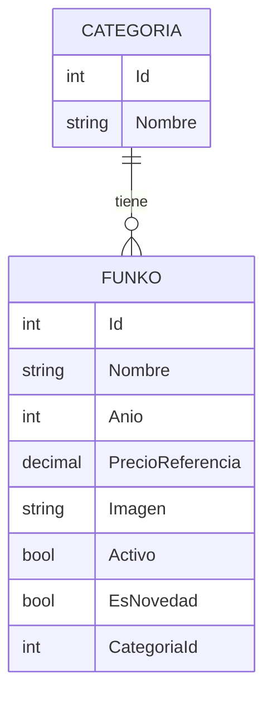
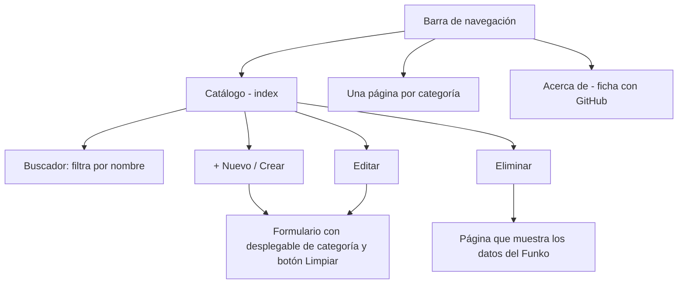

# Diseño de FunkoApp

Tienda de Funkos en dos visiones, Razor Pages (`FunkoApp`) y MVC (`FunkoAppMvc`), sobre un núcleo común (`FunkoApp.Shared`). Este documento recoge el diseño en papel (fase 1 de la práctica 3).

## Modelo de datos

Un Funko pertenece a una categoría; una categoría tiene muchos Funkos.

Por decidir: las `Etiquetas` opcionales que pide el enunciado no salen en el diseño en papel.

## Mapa de páginas

Todas las páginas comparten cabecera (barra de navegación) y pie de página (2DAW, 2026).

## Reglas de la imagen

- Si el Funko no tiene imagen, se muestra una imagen por defecto.
- Editar con imagen: se actualiza y se borra la anterior del disco.
- Eliminar con imagen: se borra también el fichero.

## Fuera de alcance por ahora

Usuarios e Identity, cesta y estado, internacionalización, caché, despliegue con Docker y pruebas con Playwright. El temario llega hasta el punto 16.
